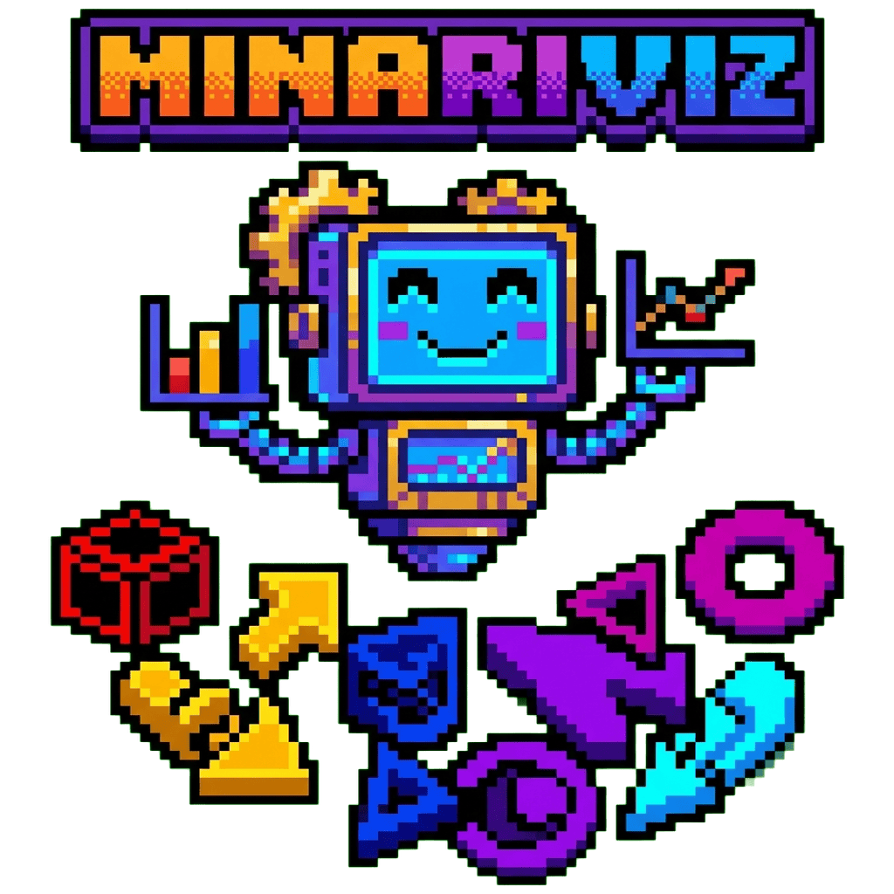

  
   
  <!-- repo-tagline:start -->
  <strong>🔬 Explore and visualize Minari offline reinforcement learning datasets 📊</strong>
  <!-- repo-tagline:end -->

[Live Demo](https://minariviz.tsilva.eu/)

minariviz helps reinforcement-learning researchers browse Minari datasets and
inspect recorded observations in the browser.

## Try it

Open the live demo, search the catalog, and select a dataset. Choose the
observation viewer to step through rendered frames and rewards from downloaded
episodes. The first load may take a minute while the service wakes up or
downloads data.

The catalog's static charts and statistics are illustrative. The observation
viewer displays actual episode data.

For local development and observation downloads, follow the
[setup and API guide](docs/observations.md). See
[production delivery](docs/production-delivery.md) for deployment.

## License

[MIT License](LICENSE).
